```mermaid

%% Generated by https://gitdiagram.com/bhangun/andalus
flowchart TD

subgraph group_interfaces["User interfaces"]
  node_cli["CLI"]
  node_rest["REST API<br/>[AgentResource.java]"]
  node_grpc["gRPC API"]
end

subgraph group_execution["Orchestration and execution"]
  node_engine["Execution engine"]
  node_agent["Agent runtime"]
  node_coordination["Coordination"]
  node_workflow["Workflow integration"]
  node_backend["Gamelan backend"]
end

subgraph group_capabilities["Runtime capabilities"]
  node_memory["Memory and context"]
  node_rag["RAG pipeline"]
  node_knowledge["Knowledge runtime"]
  node_graph["Graph runtime"]
  node_providers{{"LLM providers"}}
end

subgraph group_governance["Governance and operations"]
  node_guardrails["Guardrails"]
  node_hitl["Human review"]
  node_sandbox["Sandbox and tools"]
  node_mcp["MCP integration"]
  node_operations["Observability"]
  node_tasks[("Human-task store")]
end

node_user(("User"))

node_user -->|"starts session"| node_cli
node_user -->|"invokes agent"| node_rest
node_cli -.->|"requests execution"| node_engine
node_rest -.->|"invokes execution"| node_engine
node_grpc -.->|"dispatches work"| node_engine
node_engine -->|"executes agent"| node_agent
node_engine -->|"executes workflow"| node_workflow
node_agent -->|"requests inference"| node_providers
node_coordination -->|"delegates coordination"| node_backend
node_backend -.->|"runs workflow"| node_workflow
node_agent -->|"uses context"| node_memory
node_agent -->|"applies policies"| node_guardrails
node_agent -->|"requests review"| node_hitl
node_hitl -->|"queries tasks"| node_tasks
node_agent -.->|"retrieves knowledge"| node_rag
node_rag -.->|"uses knowledge"| node_knowledge
node_knowledge -.->|"projects graph"| node_graph
node_agent -->|"uses tools"| node_sandbox
node_sandbox -.->|"integrates tools"| node_mcp
node_engine -.->|"exposes diagnostics"| node_operations

click node_cli "https://github.com/bhangun/andalus/blob/main/cli/andalus-cli/src/main/java/tech/kayys/andalus/cli/AndalusAqliCli.java"
click node_rest "https://github.com/bhangun/andalus/blob/main/api/andalus-api-rest/src/main/java/tech/kayys/andalus/api/rest/AgentResource.java"
click node_grpc "https://github.com/bhangun/andalus/blob/main/api/andalus-api-grpc/src/main/java/tech/kayys/andalus/api/grpc/AndalusGrpcService.java"
click node_engine "https://github.com/bhangun/andalus/blob/main/runtime/andalus-runtime-core/src/main/java/tech/kayys/andalus/execution/DefaultExecutionEngine.java"
click node_agent "https://github.com/bhangun/andalus/blob/main/runtime/andalus-agent-runtime/src/main/java/tech/kayys/andalus/agent/core/memory/AgentMemoryService.java"
click node_coordination "https://github.com/bhangun/andalus/blob/main/runtime/andalus-runtime-core/src/main/java/tech/kayys/andalus/coordination/CoordinationExecutionEngine.java"
click node_workflow "https://github.com/bhangun/andalus/blob/main/runtime/andalus-workflow-runtime/src/main/java/tech/kayys/andalus/agent/integration/gamelan/AgentGamelanService.java"
click node_backend "https://github.com/bhangun/andalus/blob/main/runtime/andalus-backend-gamelan/src/main/java/tech/kayys/andalus/agent/backend/gamelan/GamelanCoordinationExecutionEngine.java"
click node_memory "https://github.com/bhangun/andalus/blob/main/runtime/andalus-memory-runtime/src/main/java/tech/kayys/andalus/memory/service/ContextEngineeringService.java"
click node_rag "https://github.com/bhangun/andalus/blob/main/runtime/andalus-rag-runtime/src/main/java/tech/kayys/andalus/rag/runtime/pipeline/DefaultRagPipeline.java"
click node_knowledge "https://github.com/bhangun/andalus/blob/main/runtime/andalus-knowledge-runtime/src/main/java/tech/kayys/andalus/knowledge/DefaultKnowledgeMutationService.java"
click node_graph "https://github.com/bhangun/andalus/blob/main/runtime/andalus-graph-runtime/src/main/java/tech/kayys/andalus/graph/runtime/GraphQueryExecutor.java"
click node_guardrails "https://github.com/bhangun/andalus/blob/main/runtime/andalus-guardrails-runtime/src/main/java/tech/kayys/andalus/guardrails/policy/PolicyBasedGuardrailsEngine.java"
click node_hitl "https://github.com/bhangun/andalus/blob/main/runtime/andalus-hitl-runtime/src/main/java/tech/kayys/andalus/hitl/service/HumanTaskService.java"
click node_sandbox "https://github.com/bhangun/andalus/blob/main/runtime/andalus-sandbox/src/main/java/tech/kayys/andalus/operator/runtime/sandbox/DefaultSandboxOperatorService.java"
click node_mcp "https://github.com/bhangun/andalus/blob/main/modules/tool/andalus-tool-mcp/src/main/java/tech/kayys/andalus/tool/mcp/McpServerActionPreviewService.java"
click node_operations "https://github.com/bhangun/andalus/blob/main/modules/andalus-hermes/src/main/java/tech/kayys/andalus/hermes/HermesOperationalService.java"
click node_tasks "https://github.com/bhangun/andalus/blob/main/runtime/andalus-hitl-runtime/src/main/java/tech/kayys/andalus/hitl/repository/HumanTaskQueryService.java"

classDef toneNeutral fill:#f8fafc,stroke:#334155,stroke-width:1.5px,color:#0f172a
classDef toneBlue fill:#dbeafe,stroke:#2563eb,stroke-width:1.5px,color:#172554
classDef toneAmber fill:#fef3c7,stroke:#d97706,stroke-width:1.5px,color:#78350f
classDef toneMint fill:#dcfce7,stroke:#16a34a,stroke-width:1.5px,color:#14532d
classDef toneRose fill:#ffe4e6,stroke:#e11d48,stroke-width:1.5px,color:#881337
classDef toneIndigo fill:#e0e7ff,stroke:#4f46e5,stroke-width:1.5px,color:#312e81
classDef toneTeal fill:#ccfbf1,stroke:#0f766e,stroke-width:1.5px,color:#134e4a
class node_cli,node_rest,node_grpc,node_user toneBlue
class node_engine,node_agent,node_coordination,node_workflow,node_backend toneAmber
class node_memory,node_rag,node_knowledge,node_graph,node_providers toneMint
class node_guardrails,node_hitl,node_sandbox,node_mcp,node_operations,node_tasks toneRose

```

```mermaid
%% Generated by https://gitdiagram.com/bhangun/andalus
flowchart TD

subgraph group_interfaces["Application interfaces"]
  node_cli["CLI"]
  node_rest["REST API<br/>[AgentResource.java]"]
  node_grpc["gRPC API"]
end

subgraph group_execution["Execution and orchestration"]
  node_agentexec["Agent execution"]
  node_execengine["Execution engine"]
  node_coordination["Coordination engine"]
  node_workflow["Workflow backend"]
end

subgraph group_governance["Governance and operations"]
  node_guardrails["Guardrails"]
  node_hitl["Human tasks"]
  node_taskquery["Task queries"]
  node_notifications["Task notifications"]
  node_sandbox["Sandbox runtime"]
  node_hermes["Operations and diagnostics"]
end

subgraph group_context["Memory and knowledge"]
  node_memory["Memory service"]
  node_context["Context engineering"]
  node_embedding["Embedding provider"]
  node_knowledge["Knowledge runtime"]
  node_graph["Graph runtime"]
  node_rag["RAG pipeline"]
end

subgraph group_integration["Backends and tools"]
  node_gamelan["Gamelan adapter"]
  node_mcp["MCP tool integration"]
end

node_user(("Agent user"))
node_llm{{"Inference provider"}}
node_result["Execution result"]

node_user -->|"invokes"| node_cli
node_user -->|"invokes"| node_rest
node_cli -.->|"starts execution"| node_agentexec
node_rest -.->|"starts execution"| node_agentexec
node_agentexec -->|"runs pipeline"| node_execengine
node_execengine -->|"returns result"| node_result
node_execengine -->|"executes workflow"| node_workflow
node_execengine -.->|"dispatches tools"| node_mcp
node_coordination -->|"uses backend"| node_gamelan
node_agentexec -->|"uses memory"| node_memory
node_context -->|"requests vectors"| node_embedding
node_agentexec -->|"applies policies"| node_guardrails
node_agentexec -->|"requests approval"| node_hitl
node_hitl -.->|"queries tasks"| node_taskquery
node_hitl -->|"sends notices"| node_notifications
node_user -.->|"invokes"| node_grpc
node_knowledge -->|"uses graph store"| node_graph
node_agentexec -.->|"uses retrieval"| node_rag
node_user -.->|"operates runtime"| node_sandbox
node_user -.->|"checks operations"| node_hermes
node_agentexec -->|"requests inference"| node_llm
node_agentexec -->|"coordinates agents"| node_coordination

click node_cli "https://github.com/bhangun/andalus/blob/main/cli/andalus-cli/src/main/java/tech/kayys/andalus/cli/AndalusAqliCli.java"
click node_rest "https://github.com/bhangun/andalus/blob/main/api/andalus-api-rest/src/main/java/tech/kayys/andalus/api/rest/AgentResource.java"
click node_grpc "https://github.com/bhangun/andalus/blob/main/api/andalus-api-grpc/src/main/java/tech/kayys/andalus/api/grpc/AndalusGrpcService.java"
click node_agentexec "https://github.com/bhangun/andalus/blob/main/runtime/andalus-runtime-core/src/main/java/tech/kayys/andalus/execution/AgentExecutionService.java"
click node_execengine "https://github.com/bhangun/andalus/blob/main/runtime/andalus-runtime-core/src/main/java/tech/kayys/andalus/execution/DefaultExecutionEngine.java"
click node_coordination "https://github.com/bhangun/andalus/blob/main/runtime/andalus-runtime-core/src/main/java/tech/kayys/andalus/coordination/CoordinationExecutionEngine.java"
click node_workflow "https://github.com/bhangun/andalus/blob/main/runtime/andalus-workflow-runtime/src/main/java/tech/kayys/andalus/agent/integration/gamelan/AgentGamelanService.java"
click node_gamelan "https://github.com/bhangun/andalus/blob/main/runtime/andalus-backend-gamelan/src/main/java/tech/kayys/andalus/agent/backend/gamelan/GamelanCoordinationExecutionEngine.java"
click node_memory "https://github.com/bhangun/andalus/blob/main/runtime/andalus-agent-runtime/src/main/java/tech/kayys/andalus/agent/core/memory/AgentMemoryService.java"
click node_context "https://github.com/bhangun/andalus/blob/main/runtime/andalus-memory-runtime/src/main/java/tech/kayys/andalus/memory/service/ContextEngineeringService.java"
click node_embedding "https://github.com/bhangun/andalus/blob/main/runtime/andalus-memory-runtime/src/main/java/tech/kayys/andalus/memory/spi/EmbeddingService.java"
click node_knowledge "https://github.com/bhangun/andalus/blob/main/runtime/andalus-knowledge-runtime/src/main/java/tech/kayys/andalus/knowledge/DefaultKnowledgeMutationService.java"
click node_graph "https://github.com/bhangun/andalus/blob/main/runtime/andalus-graph-runtime/src/main/java/tech/kayys/andalus/graph/runtime/GraphQueryExecutor.java"
click node_rag "https://github.com/bhangun/andalus/blob/main/runtime/andalus-rag-runtime/src/main/java/tech/kayys/andalus/rag/runtime/pipeline/DefaultRagPipeline.java"
click node_guardrails "https://github.com/bhangun/andalus/blob/main/runtime/andalus-guardrails-runtime/src/main/java/tech/kayys/andalus/guardrails/policy/PolicyBasedGuardrailsEngine.java"
click node_hitl "https://github.com/bhangun/andalus/blob/main/runtime/andalus-hitl-runtime/src/main/java/tech/kayys/andalus/hitl/service/HumanTaskService.java"
click node_taskquery "https://github.com/bhangun/andalus/blob/main/runtime/andalus-hitl-runtime/src/main/java/tech/kayys/andalus/hitl/repository/HumanTaskQueryService.java"
click node_notifications "https://github.com/bhangun/andalus/blob/main/runtime/andalus-hitl-runtime/src/main/java/tech/kayys/andalus/hitl/service/NotificationService.java"
click node_sandbox "https://github.com/bhangun/andalus/blob/main/runtime/andalus-sandbox/src/main/java/tech/kayys/andalus/operator/runtime/sandbox/DefaultSandboxOperatorService.java"
click node_hermes "https://github.com/bhangun/andalus/blob/main/modules/andalus-hermes/src/main/java/tech/kayys/andalus/hermes/HermesOperationalService.java"
click node_mcp "https://github.com/bhangun/andalus/blob/main/modules/tool/andalus-tool-mcp/src/main/java/tech/kayys/andalus/tool/mcp/McpServerActionPreviewService.java"

classDef toneNeutral fill:#f8fafc,stroke:#334155,stroke-width:1.5px,color:#0f172a
classDef toneBlue fill:#dbeafe,stroke:#2563eb,stroke-width:1.5px,color:#172554
classDef toneAmber fill:#fef3c7,stroke:#d97706,stroke-width:1.5px,color:#78350f
classDef toneMint fill:#dcfce7,stroke:#16a34a,stroke-width:1.5px,color:#14532d
classDef toneRose fill:#ffe4e6,stroke:#e11d48,stroke-width:1.5px,color:#881337
classDef toneIndigo fill:#e0e7ff,stroke:#4f46e5,stroke-width:1.5px,color:#312e81
classDef toneTeal fill:#ccfbf1,stroke:#0f766e,stroke-width:1.5px,color:#134e4a
class node_cli,node_rest,node_grpc,node_user toneBlue
class node_agentexec,node_execengine,node_coordination,node_workflow toneAmber
class node_guardrails,node_hitl,node_taskquery,node_notifications,node_sandbox,node_hermes toneMint
class node_memory,node_context,node_embedding,node_knowledge,node_graph,node_rag toneRose
class node_gamelan,node_mcp,node_llm,node_result toneIndigo
```

# Andalus Runtime

> **The executable, opinionated runtime for Andalus agents and workflows.**

[](https://opensource.org/licenses/Apache-2.0)

**Author:** Bhangun  
**Organization:** [kayys.tech](https://kayys.tech)

---

## 🧭 Overview

**Andalus Runtime** is the production-ready execution environment for autonomous AI agents. It builds on the **Andalus Framework** to provide:

- **Agent execution** — ReAct, Plan-and-Solve, Reflection, Research
- **Orchestration** — Multi-agent coordination, graph workflows
- **Deployment** — CLI, REST API, standalone JAR, native image
- **Integration** — LLM providers, MCP servers, A2A/ANP protocols
- **Observability** — Tracing, metrics, audit, health checks
- **Governance** — Guardrails, HITL, policy enforcement

---

## 🏗️ Architecture: Framework + Runtime

The Andalus ecosystem is split into two repositories:

```
┌─────────────────────────────────────────────────────────────────────┐
│                           Andalus Runtime                            │
│                    github.com/bhangun/andalus                        │
│                                                                     │
│  ┌─────────────────────────────────────────────────────────────┐    │
│  │                    Application Layer                         │    │
│  │  ┌─────────────┐  ┌─────────────┐  ┌─────────────────────┐   │    │
│  │  │    CLI      │  │  REST API   │  │  Standalone Runner  │   │    │
│  │  │  (Picocli)  │  │ (JAX-RS)    │  │  (andalus-runner)    │   │    │
│  │  └─────────────┘  └─────────────┘  └─────────────────────┘   │    │
│  └─────────────────────────────────────────────────────────────┘    │
│                                    │                                │
│  ┌─────────────────────────────────────────────────────────────┐    │
│  │                    Orchestration Layer                       │    │
│  │  ┌─────────────┐  ┌─────────────┐  ┌─────────────────────┐   │    │
│  │  │   Agent     │  │ Multi-Agent │  │   Coordination      │   │    │
│  │  │ Orchestrator│  │    Graph    │  │     Engine          │   │    │
│  │  └─────────────┘  └─────────────┘  └─────────────────────┘   │    │
│  └─────────────────────────────────────────────────────────────┘    │
│                                    │                                │
│  ┌─────────────────────────────────────────────────────────────┐    │
│  │                    Execution Layer                           │    │
│  │  ┌─────────────┐  ┌─────────────┐  ┌─────────────────────┐   │    │
│  │  │   Agent     │  │  Execution  │  │   Backend           │   │    │
│  │  │  Runtime    │  │   Pipeline  │  │   Adapters          │   │    │
│  │  │             │  │             │  │   (Aqli/Gamelan)  │   │    │
│  │  └─────────────┘  └─────────────┘  └─────────────────────┘   │    │
│  └─────────────────────────────────────────────────────────────┘    │
│                                    │                                │
│  ┌─────────────────────────────────────────────────────────────┐    │
│  │                    Runtime Modules                           │    │
│  │  ┌─────────────┐  ┌─────────────┐  ┌─────────────────────┐   │    │
│  │  │  Guardrails │  │    HITL     │  │   Observability     │   │    │
│  │  │   Runtime   │  │   Runtime   │  │      Runtime        │   │    │
│  │  └─────────────┘  └─────────────┘  └─────────────────────┘   │    │
│  └─────────────────────────────────────────────────────────────┘    │
└─────────────────────────────────────────────────────────────────────┘
                                    │
                                    ▼
┌─────────────────────────────────────────────────────────────────────┐
│                       Andalus Framework                              │
│                github.com/bhangun/andalus-framework                  │
│                                                                     │
│  Core Contracts • Protocols • Tools • Knowledge • Security         │
│  Resilience • Memory • Context • Providers • Plugins               │
└─────────────────────────────────────────────────────────────────────┘
```







---

## 📦 Runtime Modules

### Application Layer

| Module | Description |
|--------|-------------|
| `andalus-cli` | Command-line interface for interactive agent sessions |
| `andalus-runner` | Standalone CI/CD runner — single-shot, headless execution |
| `andalus-rest` | REST API for agent invocation and management |
| `andalus-server` | Full server with REST, WebSocket, and management endpoints |

### Orchestration Layer

| Module | Description |
|--------|-------------|
| `andalus-orchestration` | Multi-agent orchestration: sequential, parallel, routed, graph-based |
| `andalus-coordination` | Coordination strategies: centralized, decentralized, hierarchical |

### Execution Layer

| Module | Description |
|--------|-------------|
| `andalus-agent-runtime` | Core agent execution: memory service, tool executor, context planner |
| `andalus-runtime-core` | Pipeline construction, interceptor wiring, terminal handlers |
| `andalus-runtime-spi` | Runtime SPIs: `AgentExecution`, `AgentStrategy`, `ExecutionBudget` |
| `andalus-backend-aqli` | Aqli inference backend adapter |
| `andalus-backend-gamelan` | Gamelan workflow backend adapter |

### Runtime Modules

| Module | Description |
|--------|-------------|
| `andalus-guardrails-runtime` | Guardrails execution, node providers, detector orchestration |
| `andalus-hitl-runtime` | Human task execution, notifications, escalation, repository |
| `andalus-observability` | OpenTelemetry integration, health checks, metrics |
| `andalus-graph-runtime` | Graph store runtime: InMemory + Neo4j, query/upsert executors |
| `andalus-knowledge-runtime` | Knowledge resolution, mutation, audit, decision traces |
| `andalus-vector-runtime` | Vector store runtime implementations |

### Support Modules

| Module | Description |
|--------|-------------|
| `andalus-agent-runner` | Standalone agent runner for CI/CD pipelines |
| `andalus-builtin-tools` | Runtime-enabled built-in tools |
| `andalus-sandbox-runtime` | Sandbox provider implementations (Docker, local) |
| `andalus-hitl-runtime` | HITL domain entities, repositories, REST resources |

---

## 🚀 Getting Started

### Prerequisites

- **Java 25+**
- **Maven 3.9+**

### Build the Runtime

```bash
git clone https://github.com/bhangun/andalus.git
cd andalus
mvn clean install
```

### Run an Agent

```bash
# Interactive CLI
./bin/andalus chat

# Standalone runner
./bin/andalus-runner "Summarise the README"

# With options
./bin/andalus-runner --model gemini-pro --behavior THOROUGH "Analyse code quality"
```

### Programmatic Execution

```java
// Create runtime
DefaultAndalusRuntime runtime = DefaultAndalusRuntime.builder()
    .withProvider(myProvider)
    .withTools(myTools)
    .withMemory(myMemory)
    .build();

// Define agent
AgentDefinition agent = AgentDefinition.builder()
    .metadata(Metadata.builder()
        .name("code-reviewer")
        .description("Reviews code changes")
        .build())
    .goal("Review the given code for quality and security issues")
    .build();

// Execute
AgentRequest request = AgentRequest.of("Review this PR: ...");
AgentResponse response = runtime.executeAsync(agent, request).join();
```

### REST API

```bash
# Start server
./bin/andalus-server

# Invoke agent
curl -X POST http://localhost:8080/api/v1/agents/run \
  -H "Content-Type: application/json" \
  -d '{"agentId": "code-reviewer", "input": "Review this code"}'
```

---

## 🔧 Configuration

### Application Properties

```properties
# Inference backend
andalus.inference.backend=aqli
andalus.inference.model=gemini-flash

# Workflow backend
andalus.workflow.backend=gamelan
andalus.workflow.endpoint=http://localhost:8080

# Agent defaults
andalus.agent.max-steps=25
andalus.agent.timeout=PT5M
andalus.agent.behavior=BALANCED

# Guardrails
andalus.guardrails.enabled=true
andalus.guardrails.pii.blocking=true

# HITL
andalus.hitl.enabled=true
andalus.hitl.notifications.email.enabled=true

# Observability
andalus.observability.otel.enabled=true
andalus.observability.otel.endpoint=http://localhost:4317
```

### Runtime Behaviors

| Behavior | Max Steps | Timeout | Caching | Use Case |
|----------|-----------|---------|---------|----------|
| `FAST` | 15 | 2 min | Tool (5 min) | Quick queries |
| `BALANCED` | 25 | 5 min | Tool + Retrieval (30 min) | General purpose |
| `THOROUGH` | 50 | 20 min | All (2-4 hours) | Deep analysis |
| `DEBUG` | 25 | 5 min | None | Troubleshooting |

---

## 📊 Execution Pipeline

```
┌─────────────┐    ┌─────────────┐    ┌─────────────┐    ┌─────────────┐
│   Request   │───▶│   Trace     │───▶│ Authorization│───▶│ Obligations │
│             │    │ Interceptor │    │  Interceptor │    │ Interceptor │
└─────────────┘    └─────────────┘    └─────────────┘    └─────────────┘
                                                                │
                                                                ▼
┌─────────────┐    ┌─────────────┐    ┌─────────────┐    ┌─────────────┐
│   Result    │◀───│   Retry     │◀───│   Timeout   │◀───│  Terminal   │
│             │    │ Interceptor │    │ Interceptor │    │   Handler   │
└─────────────┘    └─────────────┘    └─────────────┘    └─────────────┘
```

---

## 🔗 Relationship to Framework

| Aspect | Framework | Runtime |
|--------|-----------|---------|
| **Repository** | [andalus-framework](https://github.com/bhangun/andalus-framework) | [andalus](https://github.com/bhangun/andalus) (this repo) |
| **Purpose** | Contracts, SPIs, adapters | Execution, orchestration, deployment |
| **Artifact** | Libraries (JARs) | Application / Service |
| **Dependencies** | Minimal | Depends on framework modules |
| **Audience** | Framework developers, integrators | End users, operators |

**Design principle:** The framework defines *what* an agentic system is. The runtime defines *how* it runs.


## Installation

You can install Andalus directly to your `~/.local/bin` using our multi-platform install script.
By default, it will attempt to install the high-performance GraalVM **Native Binary** for your OS and Architecture. 
If a native binary is not available, it will fallback to the JVM JAR.

**Default Installation (Native, falls back to JVM)**
```bash
curl -sSL https://raw.githubusercontent.com/kayys/andalus/main/install.sh | bash
```

**Force JVM Installation**
```bash
curl -sSL https://raw.githubusercontent.com/kayys/andalus/main/install.sh | bash -s -- --jvm
```

**Install a Specific Version**
```bash
curl -sSL https://raw.githubusercontent.com/kayys/andalus/main/install.sh | bash -s -- --version v1.0.0
```

## Architecture & Extensibility

Andalus is built with a **CDI (Contexts and Dependency Injection)** kernel and a strong **SPI-first** design. This ensures that the core platform is completely decoupled from specific agent behaviors or inference models.

The active reactor is organized around these layers:

- `agent/agent-spi`: backend-neutral contracts for agents, inference backends,
  workflow backends, tools, memory, audit, and dynamic skills.
- `agent/agent-core`: core agent services, registries, skill loading,
  tool selection, memory integration, resilience, and security.
- `agent/agent-backend-aqli`: adapter from the agent inference SPI to the
  Aqli SDK.
- `agent/agent-backend-gamelan`: adapter from the workflow SPI to the Gamelan
  SDK.
- `agent/agent-shaker`: harness and packaging support for minimal agent
  artifacts.
- `tools/`: tool SPI, OpenAPI/MCP/UTCP adapters, sandboxed execution, and tool
  runtime modules.
- `rag/`: RAG core, runtime, retrieval/config/embedding/SLO modules, and
  pluggable RAG pipeline extensions.
- `memory/`, `vector/`, `embedding/`, `graph/`: context, storage, retrieval,
  and search substrate.
- `guardrails/`, `hitl/`, `prompt/`: policy, approval, and prompt/runtime
  services.
- `runtime-quarkus`: thin Quarkus wiring over the pure Java core and backend
  adapters.
- `storage/`: Aqli model-storage plugins kept in the reactor but isolated
  behind Aqli SPI dependencies.

## Documentation

For comprehensive guides on how to build your own agents, integrate new inference providers, and configure the Aqli backend, please refer to the `docs/` directory:
- [Agent Development Guide](docs/agent-development-guide.md)
- [Inference Provider Guide](docs/inference-provider-guide.md)
- [Aqli Integration](docs/aqli-integration.md)

## Dependency Policy

Andalus must remain SDK/SPI-first:

- Use `gamelan-engine-spi`, `gamelan-sdk-client-core`, and
  `gamelan-sdk-executor-core` for workflow integration.
- Do not depend on `gamelan-engine-core` from framework modules.
- Use `aqli.version` for Aqli SDK/SPI coordinates.
- Keep runtime-specific wiring in runtime modules, not in `agent-spi`.

The parent POM enforces the `gamelan-engine-core` ban during Maven validation.

## Current Build Baseline

From this directory:

```bash
mvn -q validate -DskipTests
mvn -q -pl agent/agent-spi,tools/tools-spi -am compile -DskipTests
```

Both commands are expected to pass for the reorganized base. A focused
`agent-core` compile still exposes remaining package migration work from the
older consolidation: several files reference pre-consolidation packages such as
root-level skill SPI types, `agent.core.AgentResponse`, and old tool SPI
packages. See `docs/REORGANIZATION_STATUS.md`.

## Build Editions

The default `andalus-aqli` reactor is the community build. Pro/enterprise
add-ons are opt-in Maven profile modules so they can be tested, packaged, and
licensed separately from the default community surface.

```bash
mvn -q validate
mvn -q -Ppro-enterprise-addons -pl a2ui/a2ui-core,a2ui/a2ui-andalus -am test
```

The `pro-enterprise-addons` profile currently contributes the A2UI plugin
modules. Provider capability discovery advertises the same boundary with
`metadata.activationProfile=pro-enterprise-addons` and
`metadata.defaultCommunity=false`.

## HTTP Diagnostics

A2UI and A2A adapters expose dependency-free HTTP-shaped diagnostics for route
catalogs, binding reports, smoke probes, and readiness checks. A2UI is packaged
as a pro/enterprise add-on plugin and is not part of the default community
reactor. See
`docs/HTTP_DIAGNOSTICS_PROBES.md` for endpoints, configurable A2A paths, probe
pass/fail semantics, golden fixtures, and focused verification commands.

The main adapter slices are:

```bash
mvn -q -Ppro-enterprise-addons -pl a2ui/a2ui-core,a2ui/a2ui-andalus -am test
mvn -q -pl a2a/a2a-core,a2a/a2a-andalus -am test
```

## CLI Command Discovery

The packaged Andalus CLI exposes SDK-owned command metadata for agent shells:

```bash
andalus commands
andalus commands --surface assistant-agent --json
andalus commands --profile low-code-agent --category Runs --index --json
andalus commands --index --json
andalus commands --category "Run Specs"
andalus commands --id run-print-spec-output --json
andalus commands --contract-json-schema-id urn:andalus:contract:andalus.run.planning:v1:run-preview --json
andalus commands --contract-json-schema-id urn:andalus:contract:andalus.platform.catalog:v1:profile-list --index --json
andalus commands --contract-json-schema-id urn:andalus:contract:andalus.standard.alignment:v1:standard-alignment-health --index --json
andalus commands --contract-json-schema-id urn:andalus:contract:andalus.standard.catalog:v1:standards-catalog --index --json
andalus commands --contract-json-schema-id urn:andalus:contract:andalus.skill.catalog:v1:skill-discovery --index --json
andalus commands --contract-json-schema-id urn:andalus:contract:andalus.contract.coverage:v1:contract-command-coverage --index --json
andalus commands --contract-json-schema-id urn:andalus:contract:andalus.command.discovery:v1:commands-discovery --index --json
andalus commands --contract-json-schema-id urn:andalus:contract:andalus.workbench.discovery:v1:workbench-discovery --index --json
andalus workbench --contract-json-schema-id urn:andalus:contract:andalus.run.planning:v1:run-preview --json
andalus contracts --json
andalus contracts --index --json
andalus contracts --envelope run-preview --schema-json
andalus contracts --json-schema-id urn:andalus:contract:andalus.platform.catalog:v1:profile-list --schema-json
andalus contracts --json-schema-id urn:andalus:contract:andalus.standard.alignment:v1:standard-alignment-health --schema-json
andalus contracts --json-schema-id urn:andalus:contract:andalus.standard.catalog:v1:standards-catalog --schema-json
andalus contracts --json-schema-id urn:andalus:contract:andalus.skill.catalog:v1:skill-discovery --schema-json
andalus contracts --json-schema-id urn:andalus:contract:andalus.contract.coverage:v1:contract-command-coverage --schema-json
andalus contracts --json-schema-id urn:andalus:contract:andalus.command.discovery:v1:commands-discovery --schema-json
andalus contracts --json-schema-id urn:andalus:contract:andalus.workbench.discovery:v1:workbench-discovery --schema-json
andalus contracts --domain planning --schema-bundle-json
andalus contracts --check --json
andalus contracts --coverage --json
andalus contracts --command-id run-dry-json --json
andalus contracts --json-schema-id urn:andalus:contract:andalus.run.planning:v1:run-preview --json
andalus contracts --domain lifecycle --json
andalus contracts --schema andalus.run.planning --json
andalus contracts --envelope run-preview --json
andalus standards
andalus standards --json
andalus standards --catalog
andalus standards --catalog --json
andalus workbench --surface assistant-agent --category Runs --id run-session-context --json
andalus workbench --profile low-code-agent --category Runs --json
andalus skills
andalus skills list --surface assistant-agent --source rag --json
andalus skills list --profile low-code-agent --json
andalus skills inspect rag.retrieve --json
andalus skills search rag --surface assistant-agent --json
andalus skills search gamelan --profile low-code-agent --json
andalus run "Plan the next RAG evaluation" --json
andalus run inspect <run-id> --json
andalus run events <run-id> --json
andalus run events <run-id> --state completed --limit 20 --json
andalus run events <run-id> --after-sequence 10 --limit 20 --json
andalus run events <run-id> --follow --json
andalus run events <run-id> --follow --follow-result --json
andalus run events <run-id> --follow --follow-result-only --json
andalus run events <run-id> --follow --follow-result-only --stats --json
andalus run events <run-id> --stats --json
andalus run list --state completed --limit 10 --json
andalus run list --offset 10 --limit 10 --json
andalus run stats --state completed --json
andalus run list --tenant <id> --surface assistant-agent --json
andalus run list --profile low-code-agent --json
andalus run stats --profile low-code-agent --json
andalus run wait <run-id> --timeout-seconds 30 --json
andalus run cancel <run-id> --reason "user stop" --json
andalus --run-store .andalus/runs.properties run list --state completed --json
andalus --run-store .andalus/runs.properties run forget <run-id> --json
```

Use `--surface` to scope recommendations to a product surface, `--profile` to
scope through reusable product defaults, `--category` for one command family,
`--id` when another shell needs one stable command entry, and
`--contract-json-schema-id` when a shell needs the commands that produce one
stable JSON Schema contract. Profile-scoped JSON includes both `profileId` and
`resolvedSurfaceId` so shells can preserve
the product profile choice while rendering surface-compatible actions. Skill
profile filters resolve the profile's default skill bundle, for example
`low-code-agent` resolves to workflow, HITL, and observability skills. The same
query can filter either the command catalog or the full workbench payload. SDK
callers can use `discoverCommands(WorkbenchCommandQuery)`,
`discoverCommandsForProfile(...)`, `discoverCommandsForContractJsonSchemaId(...)`,
`workbench(WorkbenchCommandQuery)`, `workbenchForProfile(...)`, or
`workbenchForContractJsonSchemaId(...)` for the normalized lookup path. For richer shell
integrations, `commandDiscovery(WorkbenchCommandQuery)` also returns the
normalized query, command ids, categories, category summaries, category counts,
match counts, contract JSON Schema id facets, contract summaries, and
per-command contract references for JSON-producing commands.

JSON payloads that are consumed by agent shells are guarded by golden contract
fixtures under `andalus-aqli-cli/src/test/resources/contracts`.
Schema-backed golden payloads are also validated against the published SDK
schemas so fixture drift is caught before product shells consume it.
Use `andalus contracts --json` to discover the SDK-owned JSON contract catalog,
or use `andalus contracts --index --json` when a shell only needs totals,
filters, facets, and command ids. Filter either shape with `--schema`,
`--envelope`, `--command-id`, `--domain`, and `--json-schema-id`. The same
contract-discovery commands are exposed through the SDK command catalog under
the `Contracts` category. Contract descriptors include stable `commandIds`, so
shells can jump from an envelope to matching command catalog entries.
Use `andalus contracts --envelope <envelope> --schema-json` or
`andalus contracts --json-schema-id <schema-id> --schema-json` to render the
Draft 2020-12 JSON Schema document for one matching contract. Use
`andalus contracts --schema-bundle-json` with any contract filter to render a
bundle of Draft 2020-12 JSON Schema documents for all matching contracts.
Contract discovery JSON also includes aggregate `domains`, `domainCounts`,
`jsonSchemaIds`, `commandIds`, and `commandIdCounts` plus structured
`schemaSummaries`, `domainSummaries`, and `envelopeSummaries` for
product-shell filters and summary UIs. Each descriptor includes a stable
`jsonSchemaId` so shells can link directly from a contract entry to the schema
document.
Contract-aware command entries expose a `contracts` array with schema, version,
envelope, and `jsonSchemaId` references, so shells can bind command output
without reconstructing schema URNs. Command discovery and the full workbench
payload can also reverse-filter by that id with
`andalus commands --contract-json-schema-id <schema-id> --json` or
`andalus workbench --contract-json-schema-id <schema-id> --json`.
Platform catalog JSON is schema-backed as
`andalus.platform.catalog` with envelopes for `platform-status`,
`product-catalog`, `profile-list`, and `profile-detail`. It covers
`status --json`, `products --json`, `profiles --json`,
`profiles --surface ... --json`, and `profiles inspect ... --json`.
Skill catalog JSON is schema-backed as `andalus.skill.catalog` with
`skill-discovery` for `skills list/search --json` and `skill-detail` for
`skills inspect --json`. It covers dynamic capabilities from built-in, RAG,
MCP, workflow, memory, and observability sources.
Standard-alignment health JSON is schema-backed as `andalus.standard.alignment`
with `standard-alignment-health` for `standards --json`, covering readiness,
policy, registry drift, recommendations, and provider diagnostics. Standards
catalog JSON remains schema-backed as `andalus.standard.catalog` with
`standards-catalog` for `standards --catalog --json`. It covers pinned external
standard ids, aliases, versions, bindings, spec URLs, and extension attributes
for A2A, A2UI, Agentic Commerce, and future interoperability adapters.
The command discovery JSON envelope is also a first-class contract:
`urn:andalus:contract:andalus.command.discovery:v1:commands-discovery`.
That schema covers `commands --index --json` metadata and the optional
`commands` array returned by detail views.
The full workbench JSON envelope is also schema-backed as
`urn:andalus:contract:andalus.workbench.discovery:v1:workbench-discovery`.
That schema covers platform status, product catalog, command query, command
palette, command entries, and next actions for product shells that bind the
whole workbench surface.
Use `andalus contracts --check --json` in CI to validate those bidirectional
catalog links; the command exits nonzero if drift is detected.
Use `andalus contracts --coverage --json` to inspect command coverage for every
SDK-owned contract. That report is schema-backed as
`urn:andalus:contract:andalus.contract.coverage:v1:contract-command-coverage`
and keeps intentionally commandless readiness envelopes separate from broken
or incomplete command links.
Use `andalus standards` for standard-alignment readiness health, or
`andalus standards --catalog --json` when an agent shell needs the SDK-pinned
standard ids, aliases, versions, bindings, spec URLs, and extension attributes
for A2A, A2UI, Agentic Commerce, or future protocol adapters.
Run lifecycle JSON envelopes use `schema=andalus.run.lifecycle`, `version=1`,
and envelopes such as `run-result`, `run-status`, `run-events`, `run-list`, or
`run-wait`. Their Draft 2020-12 schemas describe concrete result, status,
event timeline, follow, inspection, history, wait, cancel, and forget fields,
including nested handles, cursors, pages, summaries, status rows, event rows,
and metadata maps for product-shell binding.
Run planning JSON envelopes such as `run --preflight --json` and
`run --dry-run --json` use `schema=andalus.run.planning`, `version=1`, and
envelopes such as `run-preflight` or `run-preview` for the same binding style
before a run exists. Their Draft 2020-12 schemas describe readiness, surface
policy assessment, skill assessment, normalized request, context, and parameter
fields instead of only exposing the contract marker.

## SDK Skill Registry

`andalus-aqli-sdk` now owns a small product-facing skill discovery contract:
`AgentSkillDescriptor`, `AgentSkill`, `RegisteredSkill`, `AgentSkillState`,
`AgentSkillQuery`, and `SkillRegistry`. This layer describes capabilities by
stable id, source, lifecycle state, product surfaces, input/output keys, tags,
aliases, and metadata without coupling the SDK to any concrete skill executor.
Runtime adapters can translate these entries into MCP tools, RAG retrievers,
Gamelan workflows, built-in agent skills, or future low-code platform skills.
The local SDK seeds the registry with the default Andalus capability catalog and
the CLI exposes it through `andalus skills`, `andalus skills list`,
`andalus skills inspect`, and `andalus skills search`. SDK callers can use
`skillsForProfile(...)` or `skillDiscoveryForProfile(...)` when they want the
capability bundle from a reusable product profile.

Run results include an SDK-owned lifecycle handle with `runId`, state, strategy,
terminal status, and an SDK-owned `outcome` such as `terminal` or `pending`.
This prepares the API for later submit/status/list run
commands without changing the current immediate-run behavior.
`AgentRunLifecycleService` is the SDK boundary for recording results and
serving status, history, event timelines, inspection, wait, cancel, and forget
flows; `AgentRunStore` implementations stay focused on local persistence.
Local SDK instances keep an in-memory run-status store, and `andalus run status <run-id>`
or `andalus run list --state completed --limit 10` use the same status contract
that future persistent local or remote stores can implement. `andalus run inspect
<run-id>` combines the status snapshot and event timeline for product shells
that need one lifecycle envelope, and exposes a top-level `outcome` derived
from the combined lifecycle data. Status JSON exposes an SDK-owned `outcome`
from `AgentRunOutcomes`, such as `terminal`, `pending`, or `unknown`.
`andalus run events <run-id>` returns the
SDK-owned lifecycle timeline for debugging, UI timelines, and future
streaming/status adapters. Add `--state`, `--type`,
`--after-sequence`, and `--limit` to keep long-running agent timelines bounded
for terminal UIs and product shells. Use `--follow` for a bounded cursor loop
that advances `afterSequence` until a terminal event or `--max-polls`; tune the
interval with `--poll-millis`. Add `--follow-result` when the CLI should append
a final `run-events-follow` envelope after the streamed event-window envelopes.
Use `--follow-result-only` when automation wants one final envelope with the
last event window nested under `lastEvents`; combine it with `--stats` to omit
event rows from that nested envelope. Final follow envelopes expose an
SDK-owned `outcome` from `AgentRunOutcomes`, such as `terminal` or `max-polls`,
plus `terminalState`, `terminalEventType`, and `terminalSequence` at the top
level so product shells can route terminal outcomes without parsing nested
event rows.
SDK products should use
`followRunEvents(runId, AgentRunEventsFollowOptions, Consumer<AgentRunEvents>)`
for the same cursor loop without duplicating CLI polling. Event responses include
an SDK-owned `outcome` such as `terminal`, `pending`, or `empty`, plus
`nextAfterSequence`, so pollers can feed that value back into the next request,
and a nested `cursor` envelope with sequence range and advancement metadata.
They also include returned-window `stateCounts`/`typeCounts` plus sorted
`stateSummaries`/`typeSummaries` arrays for lightweight dashboards, grouped
under a nested `summary` envelope for stable UI binding.
Use `--stats` when a poller needs cursor and summary envelopes without the event
rows.
`andalus run list` can also filter by tenant, session, product surface, and product profile, add
`--offset` for paged history reads, and returns page metadata such as
`windowStart`, `windowEnd`, `previousOffset`, `nextOffset`, and `hasMore` plus
returned-window state, surface, profile, and strategy counts plus sorted facet
summary arrays. History envelopes expose an SDK-owned `outcome` such as
`terminal`, `pending`, `unknown`, or `empty` for page-level routing. The same
pagination fields are grouped under the JSON `page`
object for product shells that prefer one stable page envelope, while counts
and summaries are grouped under `summary`. Use
`andalus run stats` when a dashboard needs the page and summary envelopes without
the run rows.
Use `--run-store <path>` or `ANDALUS_RUN_STORE` to persist local run snapshots
across CLI invocations during development. `andalus run forget <run-id>` removes
one locally recorded snapshot from that store; it does not cancel remote work.
Remote SDK mode keeps the same lifecycle methods and delegates run status and
history to remote Andalus API endpoints. `andalus run cancel <run-id>` is the
separate lifecycle verb for requesting cancellation of a non-terminal run, and
`andalus run wait <run-id>` polls status until a run reaches a terminal state or
the timeout expires. Wait JSON exposes an SDK-owned `outcome` from
`AgentRunOutcomes`, such as `terminal`, `timeout`, or `unknown`, matching the
routing style of event follow results. Cancel JSON uses the same outcome
vocabulary for `cancelled`, `not-cancellable`, and `not-found`; forget JSON
uses `forgotten` and `not-found`.


---

## 🔗 Links

- **Framework Repository:** [github.com/bhangun/andalus-framework](https://github.com/bhangun/andalus-framework)
- **Organization:** [kayys.tech](https://kayys.tech)
- **Issues:** [github.com/bhangun/andalus/issues](https://github.com/bhangun/andalus/issues)

---

## 🙏 Acknowledgments

Built with ❤️ by [Bhangun](https://github.com/bhangun) at [kayys.tech](https://kayys.tech).